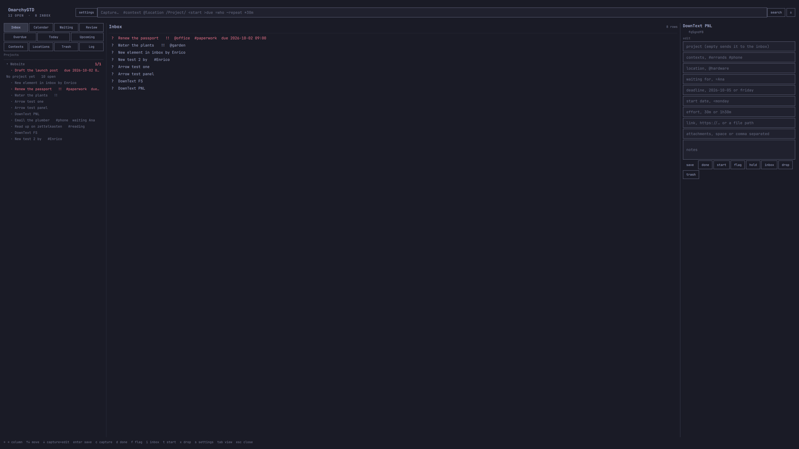
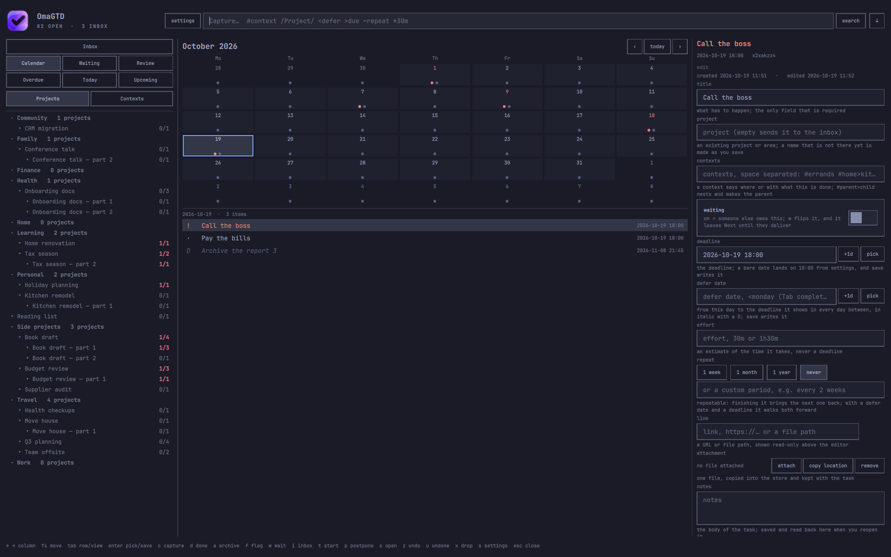

# OmaGTD

Getting Things Done for [Omarchy](https://omarchy.org/), modelled on OmniFocus.
A keyboard-driven GTD system that lives in the bar and the shell: capture into
an inbox, clarify, organize, reflect, and engage — projects/areas, contexts
(tags), waiting, someday/maybe, recurring actions, and an internal
calendar, backed by a sqlite3 database and scriptable through a `gtd` CLI.





## Human-generated content

As this is an AI-generated program and content, for human-generated
infomation about this repository, see the [HUMANS.md](HUMANS.md) file.

## What's included

- **Bar pill** — inbox and next-action counts, with a compact glyph-only mode.
- **Panel** — a quick overlay for what is on today: what is due, plus deferred
  work whose window has opened. Driven entirely by the keyboard. Its "n today"
  summary names the number of open tasks shown and wears the colour of the most
  urgent one among them, the same ladder the rows use.
- **Fullscreen view** — the whole five-step workflow, either as a layer-shell
  overlay or as a real window of its own (see *Full workflow* below).
- **Web app** — the same views in a browser, installable on a phone (see
  *On your phone* below). One server owns the database; the phone is a client.
- **`gtd` CLI** — every step is scriptable, so it can be bound to a hotkey.

## GTD in OmaGTD

OmaGTD is David Allen's five steps, each one a command you can run, script or
bind to a hotkey — and each one a view in the fullscreen app:

```
   capture ─▶ [ INBOX ] ─▶ clarify ─▶ organize ─▶ engage
                  ▲                        │
                  │                        │
                  └───── reflect ◀─────────┘
```

| Step | `gtd` command | Fullscreen view |
| --- | --- | --- |
| 1. Capture | `gtd capture` | the top bar field (`c` or `/` to focus) |
| 2. Clarify | `gtd clarify`, `gtd triage` | Inbox, and the Clarify queue |
| 3. Organize | `gtd edit`, `gtd project`, `gtd tag` | Projects / Contexts trees, drag-and-drop onto a project, a context or a day |
| 4. Reflect | `gtd review daily`, `gtd review weekly` | Review |
| 5. Engage | `gtd focus`, `gtd today`, `gtd engage` | Focus, Today, Overdue, Flagged, Upcoming |

**Step 1 — Capture.** Three doors, all into one inbox: `gtd capture` (also the
bar pill, the panel's capture field and the overlay's top field), `gtd import`
for OmniFocus exports plus `json`/`csv`/`zip`, and `gtd import-lines` for a
plain text file of one capture-style line per task. A bare capture *is* an
inbox item; give it a project, an area or a context and it becomes a next
action.

**Step 2 — Clarify.** `gtd clarify ID OUTCOME` decides what an item is, with
Allen's outcomes: `actionable` (leave the inbox), `do-now` (the two-minute
rule — done immediately), `defer` (real, but not now), `wait` (not yours to
do), `someday`, `reference`, `delete`. An `actionable` or `defer` item is
refused without a home — a project, an area or a context — because an
organized action with nowhere to live is the thing that makes people stop
trusting a system. `gtd triage` prints the queue with the decision each item
is waiting on.

**Step 3 — Organize.** Projects and areas are containers; contexts (`#tag`)
are the conditions a task can be done in, and both nest with `>`
(`Personal>Errands`, `#home>kitchen`). A project name only has to be unique
inside its parent, so `Nuvola>Amministrazione` and `Montagna>Amministrazione`
can coexist; use the full path when a bare name would be ambiguous. `gtd edit`
sets them one at a time, `gtd project`/`gtd tag` manage the containers
themselves, and the fullscreen view files a task by dragging it onto a project,
a context or a calendar day.

**Step 4 — Reflect.** `gtd review daily` is "what is true right now" — the
inbox, today, overdue and waiting. `gtd review weekly` is the Weekly Review as
a checklist in Allen's order: empty the inbox, the coming week's calendar, who
you are waiting on, someday/maybe, stalled and empty projects, what is
flagged, what is overdue, what has not moved. Projects and contexts also carry
OmniFocus's review cadence — the "Review: 12" counter that says a container
has drifted out of sight.

**Step 5 — Engage.** `gtd focus` and `gtd today` are the working lists, and
`gtd engage` (with the short verbs `gtd done`, `gtd start`, `gtd flag`,
`gtd postpone`, …) moves a single item through its life. The bar pill is the
glanceable half of this step.

**The tickler.** A `defer` date is the tickler: an item with a future defer
date is kept out of Next and Today until its date comes round, and
`gtd list forecast` (the *Upcoming* view) is what is waiting to become
available. There is one defer date per action rather than a separate
filing-cabinet tickler, and it doubles as the start date that keeps a task
from surfacing before you can work on it.

An item parked as `waiting` that has not yet been given a project, an area or
a context still shows in the inbox — it was parked before it was organized, so
it is still waiting on a decision. It keeps its `waiting` status, so the
*Waiting* view shows it too; a waiting item with a home has been decided and
stays out of the inbox.

*Someday / Maybe* is a state, not a context: the same kind of on/off decision
as waiting. Park a task with `gtd someday ID` (or `gtd edit ID --someday`),
bring it back with `gtd engage ID resume`, and revisit it in `gtd list someday`
at review time. It carries the `S` glyph and reads in italic pink in the app.

### Running each step from the CLI

```bash
# 1. capture — a bare capture lands in the inbox
gtd capture "Pay the electricity bill"      # → Inbox (7f3a2c)

# 2. clarify — see what is waiting, then decide what it is
gtd list inbox
gtd triage
gtd clarify 7f3a2c actionable --project "Home admin" --due friday
#   other outcomes: do-now | defer (needs --defer) | wait | someday | reference | delete

# 3. organize — file it, or set its context
gtd tag add home                            # create a context
gtd edit 7f3a2c --tag home                  # attach it

# 4. reflect
gtd review daily                            # the two-minute pass
gtd review weekly                           # the Weekly Review checklist

# 5. engage — work the lists
gtd focus                                   # next actions you could do right now
gtd today
gtd flag 7f3a2c                             # these short verbs are `gtd engage ID …`
gtd done 7f3a2c
```

`gtd edit ID --flag` flags an item, `--waiting` parks it as waiting for someone
else, and `--somedaymaybe` incubates it as someday/maybe. The same three flags
work on `gtd capture`.

`actionable` and `defer` require `--project`, `--area` or `--tag`; the other
outcomes do not. A capture that already names a context or a date skips the
inbox entirely, so the first two steps collapse into one:

```bash
gtd capture "Pay the electricity bill #home >friday"
```

`ID` is an item id, a unique prefix, or `last` for the item touched most
recently. Prefer the id you captured with (`gtd capture --json` prints it):
after a command that also creates a project, `last` points at that project,
not at the task.

## Install on any Omarchy PC

OmaGTD is a shell plugin, so install it with the plugin manager:

```bash
omarchy plugin add https://github.com/auino/omagtd.git --enable
```

You will be asked to confirm the git URL (plugins run unsandboxed inside the
shell — [review the code](https://github.com/auino/omagtd) if you like) and to
choose the bar section. The bar widget defaults to the right section.

Update to the latest version with:

```bash
omarchy plugin update com.auino.omagtd
```

Remove it with:

```bash
omarchy plugin remove com.auino.omagtd
```

## Full workflow

The full five-step workflow is one view,
`app/FullScreenContent.qml`, drawn in two shapes. Both live inside the running
Omarchy shell process — no second Quickshell instance — so they see the same
database and the same theme.

**The overlay** is a layer-shell surface: it covers everything, takes the
keyboard, and the bar pill summons it directly.

**The app window** is an ordinary maximized window: the bar stays visible, it
keeps its border, sits in the window list, and can be minimized or moved
between workspaces like any other window. The desktop entry and
`bin/omagtd-app` open this one; `omagtd-app overlay` opens the overlay instead.

Hyprland needs one rule to maximize it (it ignores the xdg maximized state on a
tiled window); without it the window still opens, but tiles beside its
neighbours instead of filling the workspace:

```lua
-- ~/.config/hypr/hyprland.lua
o.window({ class = "^org.quickshell$", title = "^OmaGTD$" }, { maximize = true })
```

From the overlay, `g` opens the same view as the window and closes the overlay.
`SUPER + SHIFT + G` is bound to `bin/omagtd-app`, so it brings the window up
(and focuses it if it is already open). Omarchy's default `SUPER + SHIFT + G`
opens Signal, so the user binding has to `hl.unbind` it first:

```lua
-- ~/.config/hypr/bindings.lua
hl.unbind("SUPER + SHIFT + G")
o.bind("SUPER + SHIFT + G", "OmaGTD",
  "~/.config/omarchy/plugins/com.auino.omagtd/bin/omagtd-app")
```

```bash
~/.config/omarchy/plugins/com.auino.omagtd/bin/omagtd-app              # the app window
~/.config/omarchy/plugins/com.auino.omagtd/bin/omagtd-app view today   # ... on a view
~/.config/omarchy/plugins/com.auino.omagtd/bin/omagtd-app quit         # close whichever is open
~/.config/omarchy/plugins/com.auino.omagtd/bin/omagtd-app overlay      # the fullscreen overlay
~/.config/omarchy/plugins/com.auino.omagtd/bin/omagtd-app overlay quit # close it
```

To invoke it from the terminal, symlink the wrapper onto your PATH:

```bash
ln -s ~/.config/omarchy/plugins/com.auino.omagtd/bin/omagtd-app ~/.local/bin/omagtd-app
```

One shape is open at a time: summoning the overlay hides the window and vice
versa. Each keeps its own place in the workflow, so switching back lands where
you left off.

### Repeating actions

A repeat rule (`~every week` on capture, or the repeat field in the editor)
brings the action back when it is completed. The rule moves the whole window:
with both a defer date and a deadline, both dates advance by the interval and
keep the days between them, so the next deadline never lands before the day it
opens. The default counts from completion; add `after schedule` to keep the
dates on their original calendar days and skip any occurrences already missed.

While the editor holds a repeat rule it shows the resulting next defer and next
due dates, refreshed as the rule or either date changes. That preview comes
from the same computation a real completion uses (`gtd repeat-preview`), so
what the form promises is what the new task gets.

## The `gtd` CLI

Everything the UI does is available on the command line. The plugin ships a
`gtd` launcher in `bin/`; run it directly:

```bash
~/.config/omarchy/plugins/com.auino.omagtd/bin/gtd --help
```

or via the core module (the entry point used by tests):

```bash
python3 ~/.config/omarchy/plugins/com.auino.omagtd/lib/gtd/cli.py --help
```

Common verbs: `capture` (inbox), `clarify`/`triage`, `edit`, `defer`,
`postpone`/`roll`, `open` (open an item's link), `today`, `focus`, `engage`,
`review`, `tag`/`context`, `tree`, `calendar`/`cal`, `agenda`, `settings`,
`repeat-preview` (the next defer and due a rule would produce),
`import`, `import-lines`, `export`, `export-day`, `db`.

An OmniFocus `import` reads any of its exports — a `.ofocus` document (the
folder of zipped transaction files OmniFocus writes for *File ▸ Export*),
a `.ofxml` backup, or the line-oriented `.ofocusmx` text — plus our own
`json`, `csv` and `zip`. The format is chosen by content unless `--format`
says otherwise.

`import-lines` (alias `import-txt`) reads a file nobody else wrote: one
quick-entry line per task, the syntax `capture` takes. `#errands` and
`#home>kitchen` give contexts, `/Garden fence/` a project, `/a/Home admin/` an
area, `<tomorrow` a defer window, `>friday` a deadline, `~every week` a repeat
rule, `*1h30m` an effort, `!` a flag. A project or an area the file names but
the system has never heard of is created with the tasks that belong to it — an
import file is deliberate about its containers. A line that cannot become a
task is reported with its line number and the rest still import, so one bad
line costs nothing but itself; `--dry-run` rehearses the file and undoes it,
and `--tag NAME` stamps every line with an extra context:

```bash
gtd import-lines errands.txt               # one task per line, containers and all
gtd import-lines errands.txt --dry-run     # report the plan, write nothing
gtd import-lines errands.txt --tag backlog # stamp every line with `backlog`
```

`export day` writes the commitments of a single date — what falls due that day,
the work its defer window has brought in while the deadline is still ahead (the
D rows in the app), what has already slipped past its deadline or carries none,
and what got finished — with the moment the export was taken and the command line
that produced it, to a file in markdown, HTML, JSON, YAML or PDF. One rule picks
the tasks, and it is the same for today and for any other date: a deadline on
that date, or a defer window already open by it. The export of the 5th lists what
is due on the 5th, the still-live work its defer window opened, and what the
window carried in already late; work finished that day is written too, for today.

Work whose defer window is open and whose deadline is still ahead prints under
*Deferred*; `--no-defferd-tasks` (also spelled `--no-deferred-tasks`) leaves
that group out whole. Work whose deadline has already gone by, or that has no
deadline at all, prints under *Overdue*; `--no-overdue` leaves that group out
whole, and of the day's own deadlines drops any already passed, an earlier hour
of that same day included.
The two flags are independent: dropping overdue keeps the deferred work, and
dropping deferred keeps the late work. Being date questions, neither changes a
context export. Within each group the tasks are ordered by deadline, with those
carrying no deadline last. The day, the format and the destination are all
arguments; the format is taken from the file's suffix unless `--format` says
otherwise, and with no destination the text formats go to standard out:

```bash
gtd export-day                          # today, markdown, to stdout
gtd export-day +3d --format pdf -o week.pdf
gtd export-day 2026-10-05 -o plan.yaml  # the suffix picks YAML
gtd export-day today --format html -o today.html  # pretty, self-contained page
gtd export-day --no-overdue -o today.md  # no overdue list, deferred still shown
gtd export-day --no-defferd-tasks -o today.md  # no Deferred (D) rows
gtd export-day --tag work               # every task in the `work` context
gtd export-context work                 # every task in `work`, to stdout
gtd export-context work home -o both.html  # two contexts at once
```

An export may be scoped to one or more contexts with `--tag NAME` (or its alias
`--context NAME`), or with the `export-context NAME` command. A context-scoped
export is about the context rather than the date: it lists every open task
carrying those contexts, whatever their dates, and consults no date filter at
all — nothing is dropped or separated by when it falls due, and the whole list
sits in one Context group, ordered by deadline. Naming a parent context reaches
its subcontexts too, so `export-context home` covers `home>kitchen`; the `--tag`
flag may be repeated to keep the union of several contexts.

An OmniFocus `import` stamps every imported task with a dated context,
`omnifocus_import_<yyyymmdd>`, so a batch can be found and reviewed together.
Name your own with `--tag`, or pass `--tag ''` to add none.

### Export glyphs and layout

Every export shares one vocabulary of glyphs and styles:

- `[ ]` — the square bullet that opens each action, in markdown and PDF.
- `■` — the same square bullet as a literal glyph in HTML.
- `!` — a flagged (priority) task, set in red in HTML.
- Task names are **bold** throughout (a real bold face in the PDF, `<strong>` in
  HTML, `**…**` in markdown).
- Each action is followed by its details where present: its project
  (`in …`), area, contexts (`#tag`), duration estimate, link, its defer and due
  moments, and any notes.

Both the PDF and the HTML report open with the app's own icon centred above the
date line, so a printed or viewed page is clearly an OmaGTD report. The mark
travels inside the file: the HTML page carries it as a `data:` URI and the PDF
as an image object, neither needing anything beside it. The day's groups print
in order: *Due* first, then *Deferred* — the work the day's defer window has
brought in while its deadline is still ahead — then *Overdue* — what has already
slipped past its deadline or carries none — then *Completed*; a context export
prints its one *Context* group, with every task for the context listed together. The PDF uses
the same square bullet, bold task names and full details on every page; the
HTML export renders the same document as a single self-contained page with a
small built-in stylesheet.

Both reports are dressed in the accent the app's palette setting names — the
active desktop theme's accent under `omarchy`, otherwise the preset's own — so
the wordmark, headings and bullets match the window they came from. Only the
accent travels: the page keeps its white paper and dark ink, staying readable
and printable whatever the desktop is wearing.

### Data location

Data lives in `~/.local/share/omagtd/omagtd.sqlite3` (a single sqlite3
database). Point the CLI at a different store with `--db`, or use `--profile`
for a named store under `~/.local/share/omagtd/profiles`.

### Settings

Key preferences are day-counts — empty projects and empty contexts are removed
automatically after their configured number of days, and completed tasks are
kept for a number of days:

```
gtd settings                   # show current values
gtd settings auto_remove_empty_projects 14   # keep empty projects 14 days
gtd settings auto_remove_empty_contexts 7
gtd settings done_retention_days 30
gtd settings theme of-light    # fullscreen palette: omarchy, of-light or of-dark
gtd settings fullscreen_default_view calendar   # view the app opens on: inbox, calendar, today
```

A value of `0` keeps things forever. The bar widget has its own preferences in
the plugin manager (inbox/next counts, compact mode, refresh interval).

The `theme` setting controls the fullscreen overlay palette. The default
`omarchy` follows the active desktop theme; `of-light` and `of-dark` select
OmniFocus-inspired light or dark palettes for the overlay. These palette
choices are local to OmaGTD and do not change Omarchy's shared theme. The bar
pill and quick panel always follow the desktop theme.

Row colours only mark **open** work. A task that is finished (done, archived)
or thrown away (dropped, trashed) is out of play, so it wears no status colour
— it reads dim. The one severity ladder every surface shares is
red (expired) › purple (expired waiting) › pink (someday) › orange (flagged) ›
grey (deferred) › blue (waiting). Waiting sits last because blocked work is not
work pressing on you: it never takes the colour away from a flag or the neutral
deferred state. The panel's "n today" wears the most urgent colour its list
contains; the bar pill tints the same way, but only for the loud states — grey
(deferred) and a plainly-open list keep the bar's own text colour, so the pill
never fades into the bar.

`fullscreen_default_view` picks the view the fullscreen app lands on when it
opens — `today` unless you ask for `inbox` or `calendar`. It only names the
starting point; the keyboard still moves anywhere else once the app is up.

## On your phone

The web app is the same five steps in a browser, sized for a phone and dressed
in the same palette. Its bottom bar is the fullscreen app's one-tap set —
Inbox, Calendar, Overdue, Today, Upcoming — with More offering Review
(the weekly checklist: tap a question to jump to that list, mark it reviewed
when it is done), Waiting, Someday, Projects (drill in, then back) and
Contexts (the same). It opens on the same **Opening** view the fullscreen
app does (Settings → Opening; Inbox, Calendar or Today), and the Settings pane
shows a **Serve · the phone** section: where the shared password came from,
whether the server is listening, and the three commands below.

It is not a second implementation: every request runs one command against the
same database the desktop uses, so there is nothing to sync and nothing to
merge.

### Start the server

```bash
# the password lives in a file, not in `ps`
mkdir -p ~/.local/share/omagtd
printf '%s' 'a long passphrase' > ~/.local/share/omagtd/server.password
chmod 600 ~/.local/share/omagtd/server.password

gtd serve                                   # http://127.0.0.1:8765/
gtd serve --bind 0.0.0.0 --port 8765        # when a tunnel or proxy fronts it
```

`gtd serve` is a second front door into the CLI, not a service layer: it opens
the database, journals undo, runs one handler and sweeps, exactly as `gtd
capture` does in a terminal. A file wins over the environment:
`--password-file`, else `$GTD_PASSWORD`, else
`~/.local/share/omagtd/server.password`, else `--password`. There is no
unauthenticated mode.

The password is the file's text, not a shell expression: no quotes, and
surrounding whitespace is trimmed. On startup the server prints the exact
source it read, and this checks it without listening:

```bash
gtd serve --check                       # prompts for a candidate to compare
gtd serve --check-password 'what I type'  # non-interactive form
```

If the web page says the password was not accepted, check these in order:

- The server was **restarted** after the file changed; it reads the password
  once, at startup.
- It is reading the file you think: the startup line names the path (with
  `sudo` or a different `$HOME`/`$GTD_HOME`, the default path moves).
- `$GTD_PASSWORD` is not set in the shell that starts the server; it wins over
  the default file.
- An older `gtd serve` is not still holding the port; a second start fails
  with "address already in use" and the browser keeps talking to the first.

If nothing happens at all when you press Unlock, the page is still running an
older copy of the shell. The current one switches screens with an inline style,
so a stale stylesheet cannot leave the lock painted over the app, and it treats
Enter exactly like the button. Reload once (or reinstall the home-screen app)
and press again; each press now also raises a notification on the desktop,
which tells you whether the request reached the server.

### Run it as a service

A terminal is alive only while the terminal is. On an Omarchy machine the
durable form is a systemd user service: it starts with the desktop session,
comes back if it ever exits, and keeps the same one password and one database.
The unit points at the plugin's `bin/gtd` directly, so an `omarchy plugin
update` is picked up by a restart of the unit — no copying, no symlinks.

`~/.config/systemd/user/omagtd-serve.service`:

```ini
[Unit]
Description=OmaGTD phone server (gtd serve)
After=network.target

[Service]
ExecStart=%h/.config/omarchy/plugins/com.auino.omagtd/bin/gtd serve
Restart=on-failure
RestartSec=2

[Install]
WantedBy=default.target
```

Then, in a shell:

```bash
systemctl --user enable --now omagtd-serve     # start it and start it every login
systemctl --user status omagtd-serve           # listening on 127.0.0.1:8765?
journalctl --user -u omagtd-serve -f           # its output, live
systemctl --user disable --now omagtd-serve    # taken down again, and unlinked
```

A few deliberate choices:

- The unit sets **no** `GTD_PASSWORD`. Deliberate: the password stays in the
  default file (`~/.local/share/omagtd/server.password`) that the unit's user
  can always read, and the fullscreen app's **Serve · the phone** settings
  section and `gtd serve --check` keep reporting the same source.
  To use the environment instead, add one `Environment=GTD_PASSWORD=…` line
  — but then the phone's password and the pane's report follow that value.
- Different port or listener? Extend the `ExecStart` line
  (`… serve --port 8766` or `… serve --bind 0.0.0.0`) and use the same port
  in `tailscale serve`.
- `loginctl enable-linger` makes the service run even with no one logged in;
  useful on a box that is always on for the tailnet.
- After `omarchy plugin update com.auino.omagtd`, restart the unit so the
  running server is the new code: `systemctl --user restart omagtd-serve`.

Prefer no unit at all? The Omarchy-native hook runs once per boot, after the
desktop is up. `~/bin/start-omagtd-serve.sh`:

```bash
#!/bin/bash
curl -sf http://127.0.0.1:8765/healthz >/dev/null 2>&1 && exit 0   # already served
mkdir -p ~/.local/state/omagtd
nohup ~/.config/omarchy/plugins/com.auino.omagtd/bin/gtd serve \
  >>~/.local/state/omagtd/serve.log 2>&1 &
```

then install it:

```bash
omarchy hook install post-boot ~/bin/start-omagtd-serve.sh
```

It has the same one-password, one-database guarantees — it just has no
supervisor, so a crash stays crashed until the next boot.

### Reach it from the phone

The phone needs HTTPS — not for secrecy, but because a PWA cannot install or
use a service worker over plain `http://`. Tailscale is the shortest path: it
fronts the local port with a certificate and hands you a hostname on the
tailnet, without any port opening on a public interface.

```bash
tailscale serve --bg 8765            # HTTPS in front of gtd serve; runs in the background
tailscale status                     # the "https://<machine>.<tailnet>." line is the phone's URL
tailscale serve --delete 8765        # taken down again
```

The phone just needs to be on the tailnet (`tailscale up`). Open that HTTPS
address in the phone's browser, then **Add to Home Screen**:

- **Android/Chrome** offers an install prompt; the app appears with its own icon.
- **iOS/Safari** installs from Share → *Add to Home Screen* → *Open as Web App*.

A TLS reverse proxy (Caddy, nginx + a domain) is equivalent: point it at
`http://127.0.0.1:8765` and nothing else changes. `gtd serve --bind 0.0.0.0`
then means the machine must be reachable on that interface — keep that for a
machine behind a firewall you control, and prefer keeping the listener on
loopback with the proxy in front.

Sanity check from any machine on the path:

```bash
curl -s https://<machine>.<tailnet>./healthz      # {"ok": true, "app": "omagtd"}
```

The password is asked for once and kept on that device. Adding to the home
screen is also what lets iOS keep it: Safari can evict storage for sites it has
not seen for a week, installed web apps are exempt.

### What travels, and what does not

There is one database and one writer. A change made on the phone is a row in
the same sqlite file, so:

- the bar pill, the panel and the fullscreen view see it on their next refresh
  (the bar and panel already poll every `pollIntervalSec`, 60 s by default);
- the web app learns immediately: it subscribes to `/events`, and the server
  pushes a revision whenever **any** connection commits (it watches
  `PRAGMA data_version`, so a change made in a terminal counts too).

That is the whole mechanism. No conflict resolution, no device identity, no
outbox: last command wins, which is what a single user with two devices means.

A few commands stay on the host because they touch its filesystem or its
desktop, and the server refuses them over HTTP: `open`, `attach`, `import*`,
`export*`, `notify`, `db` and `serve`. The web app opens an item's link in the
browser itself, which is the right answer for `open`.

Two honest limits: a PWA gets no home-screen widget on either platform, and
"today" is computed in the **server's** timezone, so travelling across zones
shows the day you left. Run the server in your home timezone.

### The API

One endpoint carries the commands:

```bash
curl -s http://127.0.0.1:8765/rpc \
  -H 'Authorization: Bearer a long passphrase' \
  -d '{"argv": ["capture", "Buy milk", "--due", "tomorrow"]}'
```

Reads are also available as plain `GET`s: `/v1/state?view=today` and
`/v1/item/<id>`. `GET /theme.css` serves the palette, and `GET /events` is the
change feed (the password goes in a query parameter there, because
`EventSource` cannot set a header). `/` and the static shell need no password —
they contain no data.

`POST /v1/unlock` is the explicit attempt the web app makes when you press
Unlock or Enter. The server answers `200` or `401` and, unless started with
`--no-notify-attempts`, raises one desktop notification saying that a client
was accepted or refused (with the address, never the password). A remembered
password reconnecting on page load passes `"announce": false`, so a reload
stays silent.

## Development

```bash
python3 -m unittest tests.test_gtd   # from the plugin root
```

The bar widget, quick panel, and both fullscreen shapes use the `qs.Commons` /
`qs.Ui` modules from the running Omarchy shell. `app/Ui` holds the fullscreen
view's vendored copy of the UI kit (with `FileBrowser.qml` on top, so attaching
a file never reaches a native dialog); its `BorderOverlay` reads
`BorderGeometry.js` from `app/Commons` by relative path, which is why that copy
has to stay beside it.

`GtdTheme.qml` exists twice: the root copy is shared by the bar widget and
panel, while `app/GtdTheme.qml` supplies the fullscreen view's local palette
and extra preset colors. Keep the status colors and row glyphs aligned.

## License

[MIT](LICENSE)
