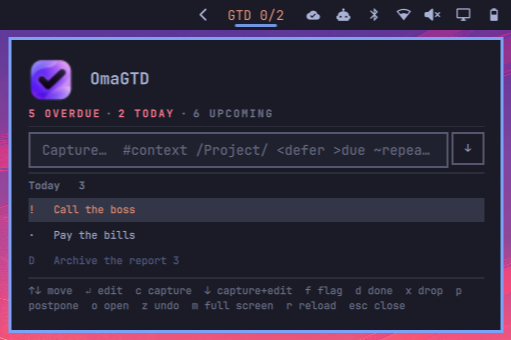
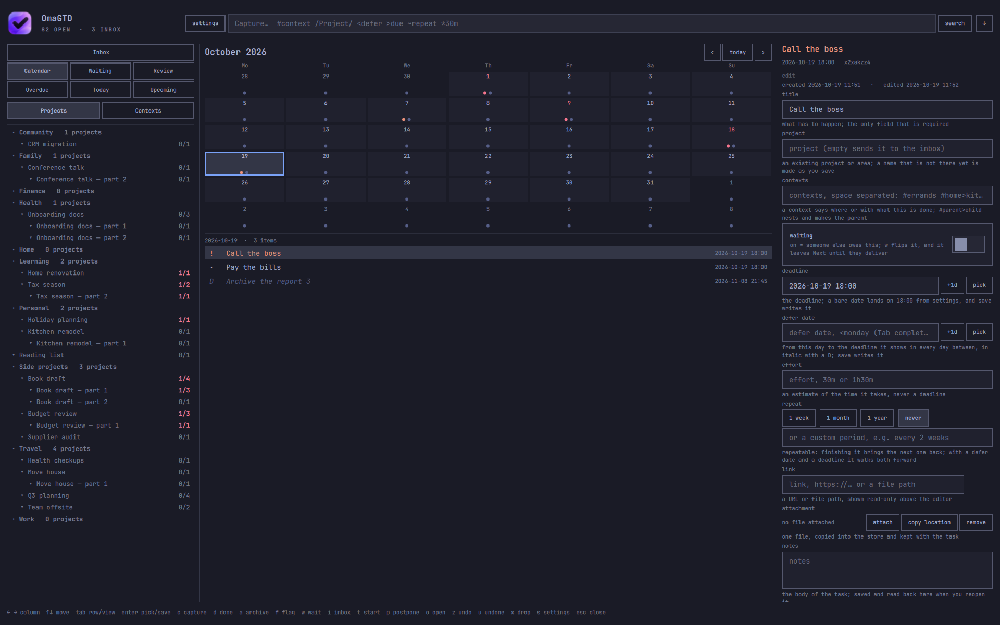

# OmaGTD

Getting Things Done for [Omarchy](https://omarchy.org/), modelled on OmniFocus.
A keyboard-driven GTD system that lives in the bar and the shell: capture into
an inbox, clarify, organize, reflect, and engage — projects/areas, contexts
(tags), waiting, someday/maybe, recurring actions, and an internal
calendar, backed by a sqlite3 database and scriptable through a `gtd` CLI.





## Human-generated content

As this is an AI-generated program and content, for human-generated
infomation about this repository, see the [HUMANS.md](HUMANS.md) file.

## What's included

- **Bar pill** — inbox and next-action counts, with a compact glyph-only mode.
- **Panel** — a quick overlay for what is on today: what is due, plus deferred
  work whose window has opened. Driven entirely by the keyboard.
- **Fullscreen view** — the whole five-step workflow in one window (see
  *Standalone app* below).
- **`gtd` CLI** — every step is scriptable, so it can be bound to a hotkey.

## Install on any Omarchy PC

OmaGTD is a shell plugin, so install it with the plugin manager:

```bash
omarchy plugin add https://github.com/auino/omagtd.git --enable
```

You will be asked to confirm the git URL (plugins run unsandboxed inside the
shell — [review the code](https://github.com/auino/omagtd) if you like) and to
choose the bar section. The bar widget defaults to the right section.

Update to the latest version with:

```bash
omarchy plugin update com.auino.omagtd
```

Remove it with:

```bash
omarchy plugin remove com.auino.omagtd
```

## Full workflow overlay

The full five-step workflow is a Quattro-managed fullscreen overlay inside the
existing Omarchy shell process. The bar widget summons it directly; no second
Quickshell process is started. The optional `omagtd-app` command is only a
convenience wrapper around the Omarchy shell IPC:

```bash
~/.config/omarchy/plugins/com.auino.omagtd/bin/omagtd-app            # open the overlay
~/.config/omarchy/plugins/com.auino.omagtd/bin/omagtd-app view today # open on a view
~/.config/omarchy/plugins/com.auino.omagtd/bin/omagtd-app quit       # close the overlay
```

To invoke it from the terminal, symlink the wrapper onto your PATH:

```bash
ln -s ~/.config/omarchy/plugins/com.auino.omagtd/bin/omagtd-app ~/.local/bin/omagtd-app
```

The window is a real toplevel, not a layer-shell overlay: it opens maximized on
the monitor it lands on, stays in the background, and closing the window quits
the app.

## The `gtd` CLI

Everything the UI does is available on the command line. The plugin ships a
`gtd` launcher in `bin/`; run it directly:

```bash
~/.config/omarchy/plugins/com.auino.omagtd/bin/gtd --help
```

or via the core module (the entry point used by tests):

```bash
python3 ~/.config/omarchy/plugins/com.auino.omagtd/lib/gtd/cli.py --help
```

Common verbs: `capture` (inbox), `clarify`/`triage`, `edit`, `defer`,
`postpone`/`roll`, `open` (open an item's link), `today`, `focus`, `engage`,
`review`, `tag`/`context`, `tree`, `calendar`/`cal`, `agenda`, `settings`,
`import`, `export`, `export-day`, `db`.

An OmniFocus `import` reads any of its exports — a `.ofocus` document (the
folder of zipped transaction files OmniFocus writes for *File ▸ Export*),
a `.ofxml` backup, or the line-oriented `.ofocusmx` text — plus our own
`json`, `csv` and `zip`. The format is chosen by content unless `--format`
says otherwise.

`export day` writes the commitments of a single date — what falls due that day,
whatever has been deferred on or before it, and what got finished — with the
moment the export was taken and the command line that produced it, to a file in
markdown, HTML, JSON, YAML or PDF. One
rule picks the tasks, and it is the same for today and for any other date: a
deadline on that date, or a defer window already open by it. The export of the
5th lists what is due on the 5th and everything available by the 5th, and
nothing else; work finished that day is written too, for today. `--no-overdue`
drops the day's already-past deadlines. Within each group the tasks are ordered
by deadline, with those carrying no deadline last. The day, the format and the
destination are all arguments; the format is taken from the file's suffix unless
`--format` says otherwise, and with no destination the text formats go to
standard out:

```bash
gtd export-day                          # today, markdown, to stdout
gtd export-day +3d --format pdf -o week.pdf
gtd export-day 2026-10-05 -o plan.yaml  # the suffix picks YAML
gtd export-day today --format html -o today.html  # pretty, self-contained page
gtd export-day --tag work               # every task in the `work` context
gtd export-context work                 # every task in `work`, to stdout
gtd export-context work home -o both.html  # two contexts at once
```

An export may be scoped to one or more contexts with `--tag NAME` (or its alias
`--context NAME`), or with the `export-context NAME` command. A context-scoped
export is about the context rather than the date: it lists every open task
carrying those contexts, whatever their dates, and consults no date filter at
all — nothing is dropped or separated by when it falls due, and the whole list
sits in one Context group, ordered by deadline. Naming a parent context reaches
its subcontexts too, so `export-context home` covers `home>kitchen`; the `--tag`
flag may be repeated to keep the union of several contexts.

An OmniFocus `import` stamps every imported task with a dated context,
`omnifocus_import_<yyyymmdd>`, so a batch can be found and reviewed together.
Name your own with `--tag`, or pass `--tag ''` to add none.

### Export glyphs and layout

Every export shares one vocabulary of glyphs and styles:

- `[ ]` — the square bullet that opens each action, in markdown and PDF.
- `■` — the same square bullet as a literal glyph in HTML.
- `!` — a flagged (priority) task, set in red in HTML.
- Task names are **bold** throughout (a real bold face in the PDF, `<strong>` in
  HTML, `**…**` in markdown).
- Each action is followed by its details where present: its project
  (`in …`), area, contexts (`#tag`), duration estimate, link, its defer and due
  moments, and any notes.

Both the PDF and the HTML report open with the app's own icon centred above the
date line, so a printed or viewed page is clearly an OmaGTD report. The mark
travels inside the file: the HTML page carries it as a `data:` URI and the PDF
as an image object, neither needing anything beside it. The day's groups print
in order: *Due* first, then *Overdue* — the work the day's defer window swept
up — then *Completed*; a context export prints its one *Context* group, with
every task for the context listed together. The PDF uses the same square bullet, bold task
names and full details on every page; the HTML export renders the same document
as a single self-contained page with a small built-in stylesheet.

Both reports are dressed in the accent the app's palette setting names — the
active desktop theme's accent under `omarchy`, otherwise the preset's own — so
the wordmark, headings and bullets match the window they came from. Only the
accent travels: the page keeps its white paper and dark ink, staying readable
and printable whatever the desktop is wearing.

### Data location

Data lives in `~/.local/share/omagtd/omagtd.sqlite3` (a single sqlite3
database). Point the CLI at a different store with `--db`, or use `--profile`
for a named store under `~/.local/share/omagtd/profiles`.

### Settings

Key preferences are day-counts — empty projects and empty contexts are removed
automatically after their configured number of days, and completed tasks are
kept for a number of days:

```
gtd settings                   # show current values
gtd settings auto_remove_empty_projects 14   # keep empty projects 14 days
gtd settings auto_remove_empty_contexts 7
gtd settings done_retention_days 30
gtd settings theme of-light    # fullscreen palette: omarchy, of-light or of-dark
```

A value of `0` keeps things forever. The bar widget has its own preferences in
the plugin manager (inbox/next counts, compact mode, refresh interval).

The `theme` setting controls the fullscreen overlay palette. The default
`omarchy` follows the active desktop theme; `of-light` and `of-dark` select
OmniFocus-inspired light or dark palettes for the overlay. These palette
choices are local to OmaGTD and do not change Omarchy's shared theme. The bar
pill and quick panel always follow the desktop theme.

## Development

```bash
python3 -m unittest tests.test_gtd   # from the plugin root
```

The bar widget, quick panel, and fullscreen overlay use the `qs.Commons` /
`qs.Ui` modules from the running Omarchy shell. The overlay loads the shared
fullscreen content in that same shell process.

`GtdTheme.qml` exists twice: the root copy is shared by the bar widget and
panel, while `app/GtdTheme.qml` supplies the fullscreen overlay's local palette
and extra preset colors. Keep the status colors and row glyphs aligned.

## License

[MIT](LICENSE)
